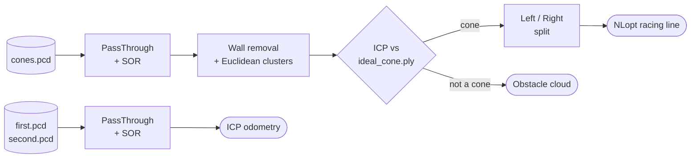

<div align="center">

# 🏎️ E‑Agle Driverless Perception

**A LiDAR-only perception pipeline for a Formula Student Driverless car, written from scratch in C++.**

Raw point cloud ➜ cones ➜ track edges ➜ racing line ➜ odometry




<sub>An animated re-creation of the bundled Qt + PCL viewer (<a href="Screenshot.png">real screenshot</a>): <b>green</b> raw cloud · <b>cyan</b> obstacles · <b>red</b> detected cones · <b>yellow</b> racing line</sub>

</div>

---

## ✨ What's inside

| Level | What it does | Where |
|:---:|---|---|
| **1** | Load, preprocess and visualize LiDAR clouds | [`GUIAndRacingLine/`](GUIAndRacingLine/) |
| **2** | Extract cones from the point cloud | [`get_cones_cloud.cpp`](GUIAndRacingLine/logic/get_cones_cloud.cpp), [`cones_recog.cpp`](GUIAndRacingLine/logic/cones_recog.cpp) |
| **3** | Split cones into left/right track edges | [`distinguish_left_right.cpp`](GUIAndRacingLine/logic/distinguish_left_right.cpp) |
| **4** | Optimize a minimum-curvature racing line | [`racingline_nlopt.cpp`](GUIAndRacingLine/logic/racingline_nlopt.cpp) |
| **5** | LiDAR odometry from pairwise ICP | [`OdometryWithProcessing/main.cpp`](OdometryWithProcessing/main.cpp) |
| **🎁** | Interactive Qt viewer with tunable sliders | [`pclviewer.cpp`](GUIAndRacingLine/pclviewer.cpp) |

> This repo covers the LiDAR path only; the camera path is not implemented.

## 🧭 Pipeline



## 🔬 How it works

**Cone extraction (L2).** A PassThrough filter crops the cloud by height, then Statistical Outlier Removal drops stray points. Region growing removes walls, and Euclidean clustering finds small blobs. Each blob is ICP-matched against an ideal cone model (`ideal_cone.ply`); good fits become cone centroids.

**Left/right split (L3).** Greedy growth on both sides follows the local heading, taken from the last two cones. A cone is *left* if its cross product with the heading is positive, otherwise *right*. An angle gate rejects zig-zags.

**Racing line (L4).** Decision variables are lateral offsets along the normals of the left/right midpoints. The objective is squared curvature plus a small smoothness term, with bounds that keep the line inside the corridor. Solved with derivative-free `LN_BOBYQA`.

**Odometry (L5).** Two consecutive scans are filtered the same way and registered with ICP. The resulting transform gives the displacement between frames.

## 🚀 Build & run

> Tested on macOS 15 (Apple M3). Requires PCL, VTK, Qt 5/6 and NLopt.

<details open>
<summary><b>GUIAndRacingLine</b>: interactive viewer + full pipeline</summary>

```bash
cd GUIAndRacingLine
cmake -DCMAKE_BUILD_TYPE=Debug -G Ninja -S . -B cmake-build-debug
cmake --build cmake-build-debug
./cmake-build-debug/pcl_visualizer
```

Pick `external_files/cones.pcd` and `external_files/ideal_cone.ply`, hit **Load**, then **Compute**. Use the *SOR*, *ConeRec* and *Line* tabs to tune parameters live.
</details>

<details>
<summary><b>OdometryWithProcessing</b>: pairwise ICP</summary>

```bash
cd OdometryWithProcessing
cmake -DCMAKE_BUILD_TYPE=Debug -G Ninja -S . -B cmake-build-debug
cmake --build cmake-build-debug
./cmake-build-debug/sample_consensus "external files/first.pcd" "external files/second.pcd"
```
</details>

## 📁 Repository map

```
GUIAndRacingLine/          Qt + PCL viewer and the full cone → racing-line pipeline
  logic/                   cone extraction, ICP cone matching, left/right, NLopt
  external_files/          sample cloud (cones.pcd) + cone template (ideal_cone.ply)
OdometryWithProcessing/    Level 5 ICP odometry on two scans
GenConeTool/               Python script that generates synthetic cone models
Report/                    project report + original task brief
docs/                      figures and technical write-up
other/                     R&D sandboxes (PCL experiments, earlier branches)
```

📊 Numbers and effort breakdown: [`STATS.md`](STATS.md)

## 🛣️ Future work

- Dataset loaders and scripted benchmarks for reproducibility
- Robust outlier rejection and loop closure for odometry
- Export edges and racing line as PCD/CSV for downstream modules
